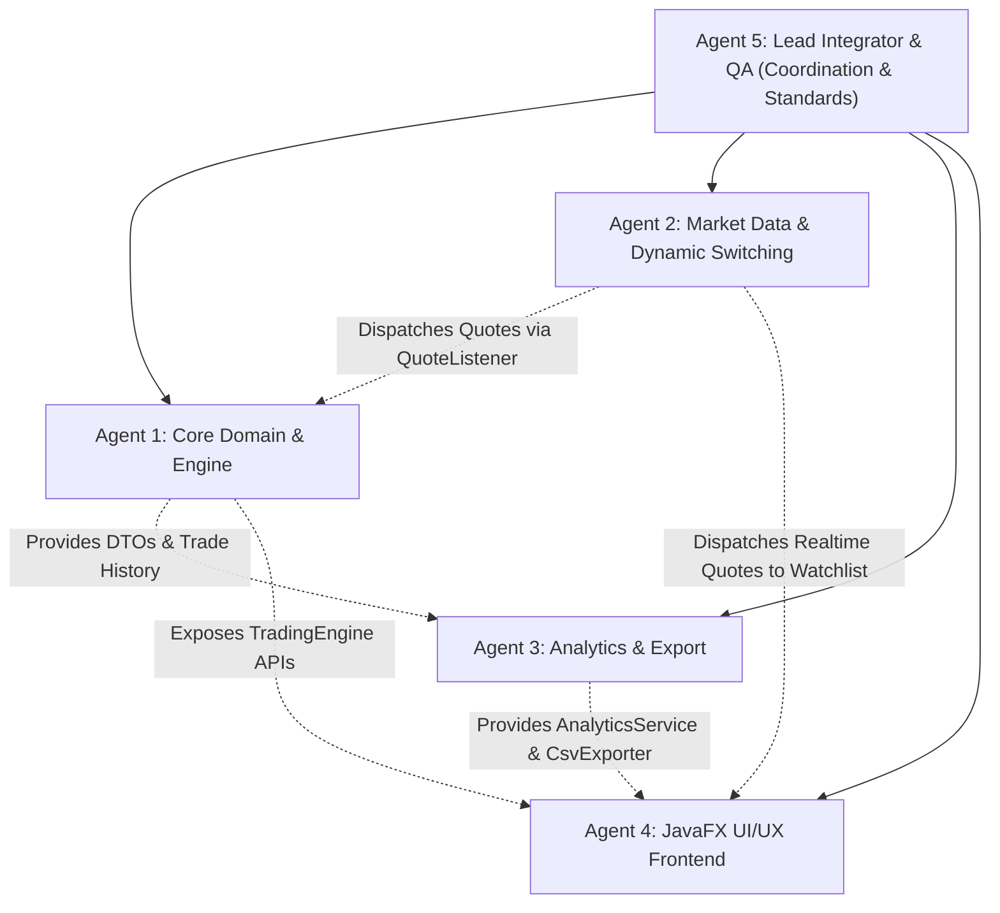
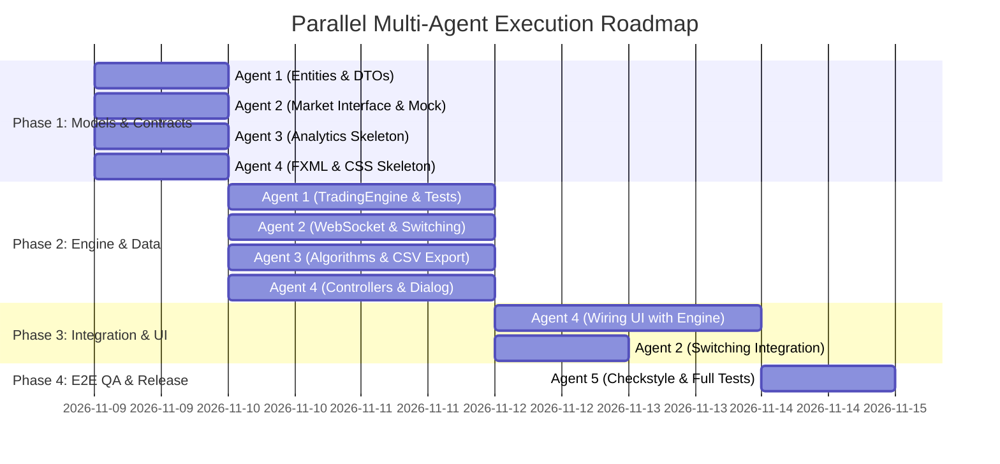

# MULTI-AGENT SPECIFICATION & COORDINATION DIRECTIVE (AGENTS.MD)
## PROJECT: REAL-TIME PAPER TRADING SIMULATION SYSTEM

---

## 1. SYSTEM OVERVIEW & MULTI-AGENT ARCHITECTURE

The **Paper Trading Simulation** system is a standalone desktop application built with **Java (JDK 21/22)** and **JavaFX**. The application delivers a real-time simulated stock trading environment supporting dynamic runtime switching between multiple market data providers (**Twelve Data**, **Finnhub**, and an embedded offline **Mock Engine**) directly from the graphical user interface, coupled with comprehensive portfolio analytics and reporting capabilities.

To optimize parallel development, eliminate source code conflicts, and enforce technical quality gates, the project is structured into **05 Specialized Agents**:



---

## 2. UNIVERSAL CROSS-CUTTING INVARIANTS FOR ALL 5 AGENTS

Every Agent initializing, editing, or testing code MUST strictly adhere to the following 7 core invariants:

### 2.1. Google Checkstyle Compliance (Zero-Warning Policy)
The codebase enforces `config/checkstyle/google_checks.xml` with `maxWarnings = 0` and `ignoreFailures = false`.
* **Indentation:** Exactly **2 spaces** per indentation level. **Tab characters (`\t`) are strictly forbidden**.
* **Line Length:** Maximum **100 characters** per line (including comments).
* **No Wildcard Imports:** `import java.util.*` and `import javafx.scene.control.*` are prohibited. Every imported class must be explicitly specified per line.
* **K&R Braces:** All control structures (`if`, `else`, `for`, `while`, `do`) **must include curly braces `{ }`**, even for single-line statements.
* **Naming Conventions:**
  * Packages: Lowercase only (`com.trading.model`, `com.trading.engine`, `com.trading.market`).
  * Classes / Interfaces / Enums: `UpperCamelCase`.
  * Methods / Variables / Fields: `lowerCamelCase`.
  * Constants: `UPPER_SNAKE_CASE` (e.g., `DEFAULT_INITIAL_CASH`).

### 2.2. Architectural Layering & Encapsulation
* **Independent Layering:** Core business modules (`com.trading.model`, `com.trading.engine`, `com.trading.analytics`) **must NEVER import JavaFX classes (`javafx.*`)**. Core domain logic must remain pure Java for fast, headless unit execution.
* **Strict Encapsulation:**
  * All fields must be declared `private` or `private final`.
  * Never expose internal mutable collections. All collection getters must return wrapped collections via `Collections.unmodifiableList(...)` / `Collections.unmodifiableMap(...)` or provide defensive copies.
* **Program to Interfaces:** Depend upon abstractions (`MarketService`, `QuoteListener`) rather than concrete implementations.

### 2.3. Threading Model & Concurrency Safety
* **JavaFX UI Updates:**
  * Market WebSockets and Mock engines execute on background daemon threads. **Any state or visual mutation of JavaFX components** (updating labels, tables, or charts) **MUST be dispatched via:**
    ```java
    Platform.runLater(() -> {
      // UI update logic here
    });
    ```
  * Never execute blocking I/O, heavy computation, or `Thread.sleep()` on the JavaFX Application Thread.
* **Shared State Safety:**
  * Concurrently accessed resources (`pendingOrders`, `globalListeners`, `Account`) must utilize thread-safe structures (`CopyOnWriteArrayList`, `CopyOnWriteArraySet`, `ConcurrentHashMap`) or explicit `synchronized` locks.
  * Keep `synchronized` blocks concise; never hold locks during network I/O or file system operations.

### 2.4. Minimal Dependency Footprint
Rely primarily on the standard JDK 21/22 runtime and approved dependencies declared in `build.gradle`:
* **REST APIs:** Use built-in `java.net.http.HttpClient` (do not add OkHttp or Apache HttpClient).
* **CSV Generation:** Use `java.nio.file.Files` and `java.io.BufferedWriter` (do not add OpenCSV / Commons CSV).
* **Date & Time:** Exclusively use `java.time.*` (`Instant`, `Duration`, `DateTimeFormatter`). Never use `java.util.Date` or `Calendar`.
* **Approved External Dependencies:**
  * `org.java-websocket:Java-WebSocket:1.5.6`
  * `com.fasterxml.jackson.core:jackson-databind:2.17.0`
  * OpenJFX 21 (`javafx.controls`, `javafx.fxml`)
  * Testing: `JUnit 5` (`junit-jupiter`) and `Mockito` (`mockito-core`, `mockito-junit-jupiter`).

### 2.5. Defensive Programming & Edge Cases
* **No Swallowed Exceptions:** Never write empty `catch (Exception e) {}` blocks. Every exception must be appropriately logged or handled.
* **Input Validation:** Order quantities and monetary values must always be positive ($> 0$).
* **Safe Mathematical Computations:** Guard against divisions by zero and empty collections. Return `0.0` or `Optional.empty()` instead of throwing `ArithmeticException`, `IndexOutOfBoundsException`, or `NullPointerException`.

### 2.6. Offline-First Unit Testing
* All test suites executed via `./gradlew test` must pass 100% in a network-isolated environment.
* Network and API calls must be stubbed using `MockMarketService`, JSON fixtures, or `Mockito`.
* Use numeric tolerances for floating-point comparisons: `assertEquals(expected, actual, 0.001);`.

### 2.7. Pre-Merge Verification Checklist
Before submitting code, an Agent must successfully run the following tasks:
```bash
./gradlew checkstyleMain checkstyleTest
./gradlew compileJava compileTestJava
./gradlew test
```

---

## 3. DETAILED SPECIFICATIONS PER AGENT

---

### 3.1. AGENT 1: CORE DOMAIN & TRADING ENGINE

#### A. Objectives & Scope
Construct the financial domain models, user account management, and the central order matching engine (`TradingEngine`).

#### B. Assigned Source Files
* `src/main/java/com/trading/model/`
  * `Order.java` (Abstract base order definition)
  * `MarketOrder.java` (Immediate market execution order)
  * `LimitOrder.java` (Price-conditional pending order)
  * `OrderStatus.java` (Enum: `PENDING`, `FILLED`, `CANCELLED`, `REJECTED`)
  * `Position.java` (Quantity tracking & weighted average price)
  * `Account.java` (Cash balance, portfolio positions & trade logs)
  * `Quote.java` (Real-time market price data transfer object)
  * `Trade.java` (Immutable executed trade record)
* `src/main/java/com/trading/engine/`
  * `TradingEngine.java` (Order validation, cash verification & matching engine)
* `src/test/java/com/trading/model/`
  * `OrderPolymorphismTest.java`
  * `PositionCalculationTest.java`
* `src/test/java/com/trading/engine/`
  * `TradingEngineTest.java`

#### C. Interface Contracts
* **Provided to Agent 3 (Analytics):**
  * `account.getTradeHistory(): List<Trade>`
  * `account.getEquityHistory(): List<Double>`
* **Provided to Agent 4 (UI):**
  * `tradingEngine.placeOrder(Order order, double currentPrice): boolean`
  * `tradingEngine.cancelOrder(String orderId): boolean`
  * `tradingEngine.getPendingOrders(): List<Order>`
  * `account.getCashBalance(): double`
  * `account.getTotalValue(Map<String, Double> currentPrices): double`
  * `account.getPositions(): Map<String, Position>`
* **Received from Agent 2 (Market Data):**
  * Implement `QuoteListener` to consume tick events via `onPriceUpdate(Quote quote)`.

#### D. Core Algorithms
1. **Polymorphic Order Execution (`Order.canExecute(double currentPrice)`):**
   * `MarketOrder`: Always returns `true`.
   * `LimitOrder`: Returns `currentPrice <= limitPrice` for BUY; returns `currentPrice >= limitPrice` for SELL.
2. **Weighted Average Cost Basis:**
   $$\text{AvgPrice}_{new} = \frac{(\text{Qty}_{old} \times \text{AvgPrice}_{old}) + (\text{Qty}_{add} \times \text{Price}_{buy})}{\text{Qty}_{old} + \text{additionalQty}}$$
3. **Realized Profit & Loss (P&L):**
   $$\text{Realized PnL} = (\text{sellPrice} - \text{averagePrice}) \times \text{sellQty}$$
   *Note:* The average cost basis of the remaining stock shares remains unaffected upon partial sales.

---

### 3.2. AGENT 2: MARKET DATA & DYNAMIC SWITCHING

#### A. Objectives & Scope
Build the WebSocket market communications layer, runtime dynamic provider switching mechanism, and the standalone internal `MockMarketService`.

#### B. Assigned Source Files
* `src/main/java/com/trading/market/`
  * `MarketProviderType.java` (Enum: `TWELVE_DATA`, `FINNHUB`, `ALPHA_VANTAGE`, `MOCK_ENGINE`)
  * `MarketService.java` (Standardized provider adapter interface)
  * `MarketServiceProviderManager.java` (Strategy & Registry Manager orchestrating runtime switching)
  * `QuoteListener.java` (Functional interface for quote distribution)
  * `TwelveDataWebSocket.java` (Twelve Data WebSocket adapter)
  * `FinnhubWebSocket.java` (Finnhub WebSocket adapter)
  * `MockMarketService.java` (Random Walk price generator emitting ticks every 1 second)
* `src/main/java/com/trading/ui/SettingsController.java`
* `src/main/resources/fxml/SettingsView.fxml`
* `src/main/resources/config/config.properties`
* `src/test/java/com/trading/market/`
  * `MockMarketServiceTest.java`
  * `TwelveDataJsonParserTest.java`
  * `FinnhubJsonParserTest.java`
  * `MarketProviderSwitchingTest.java`

#### C. Interface Contracts
* **Provided to Agent 1 (Engine) & Agent 4 (UI):**
  * `marketServiceManager.registerProvider(MarketProviderType type, MarketService service)`
  * `marketServiceManager.switchProvider(MarketProviderType newType, String apiKey)`
  * `marketServiceManager.addGlobalListener(QuoteListener listener)`
  * `marketServiceManager.subscribe(String symbol)`
  * `marketServiceManager.getActiveService(): MarketService`
  * `marketServiceManager.getActiveProviderType(): MarketProviderType`

#### D. Core Mechanisms
1. **Dynamic Provider Switching Workflow:**
   * When invoking `switchProvider(newType, apiKey)`:
     1. Invoke `activeService.stop()` to cleanly close existing WebSocket connections.
     2. Update `apiKey` on the target provider adapter corresponding to `newType`.
     3. Transfer all registered `globalListeners` to the new provider adapter.
     4. Call `newService.start()`.
     5. Automatically re-subscribe all symbols currently in `subscribedSymbols`.
2. **Offline Simulation Engine (Mock Market):**
   * Employs `ScheduledExecutorService` generating synthetic prices every 1 second across watchlist symbols (`AAPL`, `MSFT`, `TSLA`...).
   * Prices fluctuate within a Random Walk range of $\pm 0.5\% - 2.0\%$, strictly constrained to $> 0$.

---

### 3.3. AGENT 3: ANALYTICS & EXPORT

#### A. Objectives & Scope
Implement portfolio performance calculation algorithms, export RFC 4180-compliant trade reports, and construct the analytics UI view.

#### B. Assigned Source Files
* `src/main/java/com/trading/analytics/`
  * `AnalyticsService.java` (Utility class providing static analytical methods)
  * `CsvExporter.java` (RFC 4180 trade log exporter)
* `src/main/java/com/trading/ui/AnalyticsController.java`
* `src/main/resources/fxml/AnalyticsView.fxml`
* `src/test/java/com/trading/analytics/`
  * `AnalyticsServiceTest.java`
  * `CsvExporterTest.java`

#### C. Interface Contracts
* **Provided to Agent 4 (UI):**
  * `AnalyticsService.calculateWinRate(List<Trade> trades): double`
  * `AnalyticsService.calculateTotalPnL(List<Trade> trades): double`
  * `AnalyticsService.calculateMaxDrawdown(List<Double> equityHistory): double`
  * `AnalyticsService.getBestTrade(List<Trade> trades): Optional<Trade>`
  * `AnalyticsService.getWorstTrade(List<Trade> trades): Optional<Trade>`
  * `CsvExporter.exportTrades(List<Trade> trades, Path targetPath): void`
  * `analyticsController.loadData(List<Trade> trades, List<Double> equityHistory)`

#### D. Analytical Formulas & Formats
1. **Win Rate Calculation:**
   $$\text{Win Rate} = \frac{\text{Count of closed SELL trades with RealizedPnL} > 0}{\text{Total count of closed SELL trades}} \times 100\%$$
   *Returns `0.0` when no sell trades exist.*
2. **Maximum Drawdown (MDD):**
   $$\text{Drawdown}_t = \frac{\text{Peak}_t - \text{Equity}_t}{\text{Peak}_t} \times 100\%$$
   *Extracts the maximum historical drawdown percentage. Returns `0.0` if history has $< 2$ points.*
3. **CSV Export Standard (RFC 4180):**
   * Encoded in UTF-8 with a Byte Order Mark (**BOM: `\uFEFF`**) ensuring seamless rendering in Microsoft Excel.
   * Required Headers: `TradeID,Timestamp,Symbol,Action,Quantity,ExecutedPrice,RealizedPnL`.

---

### 3.4. AGENT 4: JAVAFX UI/UX FRONTEND

#### A. Objectives & Scope
Develop the presentation layer (main dashboard, order submission dialog, real-time charts), integrate asynchronous thread dispatching, and style with a modern Dark Theme.

#### B. Assigned Source Files
* `src/main/java/com/trading/MainApp.java` (JavaFX lifecycle & clean shutdown hooks)
* `src/main/java/com/trading/ui/`
  * `MainController.java` (Main dashboard controller)
  * `OrderDialogController.java` (Order submission dialog controller)
* `src/main/resources/`
  * `fxml/MainView.fxml` (Dashboard FXML layout)
  * `fxml/OrderDialog.fxml` (Order entry modal dialog)
  * `css/dark-theme.css` (Trading terminal dark theme styling)
* `src/test/java/com/trading/ui/`
  * `OrderDialogValidationTest.java`

#### C. UI Layout & Data Binding Requirements
1. **Main Dashboard (`MainView.fxml`):**
   * **Header Summary:** Real-time displays for Cash Balance, Total Portfolio Equity, and Net P&L.
   * **Quick Provider Selector:** `ComboBox<MarketProviderType>` allowing instant runtime data switching, accompanied by `lblProviderStatus`.
   * **Watchlist Table:** Displays symbols, live prices, and session percentage changes.
   * **Real-time Price Chart:** `LineChart` graphing price variations for the active symbol, **capped at the latest 30 points** to avoid memory leaks.
   * **TabPane:** Organizes Active Positions, Pending Orders, and Executed Trade History.
2. **Order Submission Dialog (`OrderDialog.fxml`):**
   * Inputs: Symbol picker, Order Type (`MARKET` / `LIMIT`), Limit Price, and Quantity.
   * Limit Price field is automatically disabled when `MARKET` order type is selected.
   * Computes and displays estimated order cost before submission.
3. **Threading & Lifecycle Rules:**
   * All incoming price events must update controls within `Platform.runLater()`.
   * Register `stage.setOnCloseRequest(...)` to invoke `marketServiceManager.getActiveService().stop()` on exit.

---

### 3.5. AGENT 5: LEAD INTEGRATOR & QA

#### A. Objectives & Scope
Supervise strict adherence to code standards, resolve file merge boundaries, coordinate multi-tier integration, and validate comprehensive end-to-end regression workflows.

#### B. Key Responsibilities
1. **Continuous Checkstyle Enforcement:**
   * Execute `./gradlew checkstyleMain checkstyleTest` after every integration commit.
   * Reject any pull requests or code additions containing Checkstyle warnings ($> 0$).
2. **Build Configuration Verification:**
   * Guarantee stable compatibility between JavaFX 21, Gradle 9.x, and Java 21/22.
3. **End-to-End (E2E) Integration Scenario:**
   * Test workflow: Start app on `MockMarketService` $\rightarrow$ Submit Buy Market Order $\rightarrow$ Validate cash deduction and position update $\rightarrow$ Submit Buy Limit Order below market $\rightarrow$ Trigger price descent to limit price $\rightarrow$ Verify automated execution $\rightarrow$ Sell to realize profit $\rightarrow$ Open Analytics view $\rightarrow$ Verify Win Rate and Max Drawdown $\rightarrow$ Export CSV report $\rightarrow$ Switch provider to Finnhub / Twelve Data.

---

## 4. PARALLEL EXECUTION PHASES



---

## 5. RACI RESPONSIBILITY MATRIX

| Package / Artifact | Agent 1 (Core) | Agent 2 (Market) | Agent 3 (Analytics) | Agent 4 (UI) | Agent 5 (Lead QA) |
|---|---|---|---|---|---|
| `com.trading.model.*` | **R / A** | C | C | C | I |
| `com.trading.engine.*` | **R / A** | C | I | C | I |
| `com.trading.market.*` | C | **R / A** | I | C | I |
| `com.trading.analytics.*` | C | I | **R / A** | C | I |
| `com.trading.ui.*` & `*.fxml` | C | C | C | **R / A** | I |
| `config/checkstyle/*` | C | C | C | C | **R / A** |
| `build.gradle` | C | C | C | C | **R / A** |

*Legend:*
* **R (Responsible):** Authors the code and manages implementation details.
* **A (Accountable):** Approves architecture and verifies test adequacy.
* **C (Consulted):** Collaborates on API contracts and shared data flows.
* **I (Informed):** Notified of interface or structural modifications.

---

## 6. DEFINITION OF DONE (DOD)

A task assigned to any Agent is deemed complete and ready for integration into the `main` branch only when:
1. **Compilation Clean:** `./gradlew compileJava compileTestJava` succeeds without errors.
2. **Zero Checkstyle Warnings:** `./gradlew checkstyleMain checkstyleTest` reports `0 warnings`.
3. **100% Unit Test Pass:** All JUnit 5 test cases within the module pass green.
4. **Offline Isolation:** All unit tests execute entirely offline without requiring external API keys or network sockets.
5. **Thread-Safe UI Operations:** Free of `IllegalStateException: Not on FX application thread` and confirmed free of race conditions.
