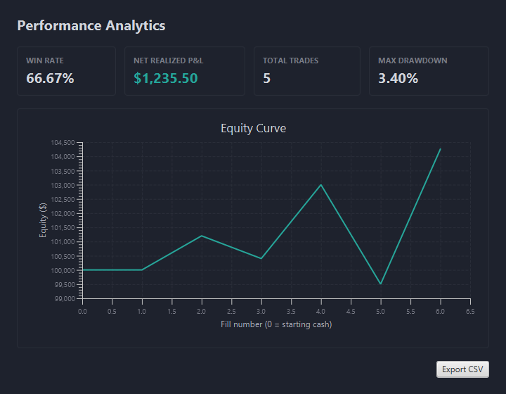

# Analytics window — hand-off from Agent 3 to Agent 4

**From:** Agent 3 (Analytics & Export)
**To:** Agent 4 (JavaFX UI/UX), owner of `ui/**` and `resources/fxml/**` (AGENTS.md §4.2)
**Built against:** `frontend-update` at commit `8e057a5`
**Requires:** `com.trading.analytics.AnalyticsService` and `CsvExporter` from
`feature/analytics`

Agent 4 owns the two window files, so this folder contains reference code, not a commit to
`ui/**`. Apply it, adapt it, or reject it; the behaviour in section 2 is what Agent 3 asks
for.



## 1. Files in this folder

| File | Replaces on `frontend-update` |
|---|---|
| `AnalyticsController.java` | `src/main/java/com/trading/sim/ui/AnalyticsController.java` |
| `AnalyticsView.fxml` | `src/main/resources/fxml/AnalyticsView.fxml` |
| `preview.png` | (illustration only) |

## 2. Required behaviour

1. **No financial formulas in the controller** (AGENTS.md §5.5). The current controller
   computes win rate, P&L and drawdown itself. The reference calls
   `AnalyticsService.calculateWinRate`, `calculateTotalPnL` and `calculateMaxDrawdown`.
2. **Tiles:** Win Rate %, Net Realized P&L $, Total Trades (BUY and SELL), Max Drawdown %.
3. **P&L colour through CSS classes:** `profit-text` when the value is 0 or more, `loss-text`
   when negative. Both already exist in `dark-theme.css` with `#26a69a` and `#ef5350`. No
   inline styles.
4. **Equity curve:** `LineChart` with symbols off, legend off, animation off, and
   `forceZeroInRange="false"` on both axes. X is the fill number (0 = starting cash), Y is
   equity.
5. **Empty state:** with fewer than two equity points the chart is hidden and a message is
   shown. `initialize()` only shows this empty state; `loadData` does the rendering.
6. **Export button `btnExportCsv`:** save dialog, default name `trading_report.csv`, filter
   `*.csv`. Cancel does nothing. The file is written by `CsvExporter.exportTrades` on a
   background thread (AGENTS.md §6.4); success and failure are reported with an `Alert` on
   the FX thread. The failure message contains no stack trace; the exception is logged.
   The button is disabled while an export runs and when there are no trades.

## 3. Public contract

```java
public void loadData(List<Trade> tradeHistory, List<Double> equityHistory)
```

- Must be called on the JavaFX Application Thread.
- Null lists are treated as empty. The controller copies both lists.
- This renames the current `initData(...)`. The name `loadData` follows `docs/ANALYTICS.md`
  §4; `docs/FRONTEND.md` §4.3 still shows a one-argument `initData` and should be updated.

`fx:id` values the controller expects: `winRateLabel`, `realizedPnLLabel`, `tradeCountLabel`,
`maxDrawdownLabel` (all unchanged), plus the new `equityChart`, `emptyStateLabel` and
`btnExportCsv`.

## 4. Changes needed in `MainController.openAnalytics()`

```java
controller.loadData(
    List.copyOf(account.getTradeHistory()), List.copyOf(account.getEquityHistory()));
showChildWindow("Performance Analytics", root, 720, 560);
```

`List.copyOf` makes the snapshot explicit at the module boundary; it is free today because
`Account` already returns unmodifiable copies. The window grows from 600x480 to 720x560 to
fit the chart. See `docs/handoff/ANALYTICS_INTEGRATION.md` for the full integration package.

## 5. Differences from the current implementation that change displayed numbers

- **Net P&L** now sums SELL trades only (AGENTS.md §5.4). The current code sums every trade.
  The two agree as long as BUY records carry a realized P&L of 0.
- **Negative P&L** is shown as `-$80.00` in `loss-text`; the current label always keeps
  `profit-text`.

## 6. What Agent 3 verified, and what it did not

Verified on a scratch checkout of `frontend-update` plus the two analytics classes
(JDK 21 daemon, toolchain 22):

- `gradlew checkstyleMain compileJava compileTestJava test`: BUILD SUCCESSFUL, including the
  existing `UiResourceTest` (FXML well-formed) and `OrderFormValidatorTest`.
- Off-screen render of the FXML with the dark theme for three data sets (loaded, empty,
  loss). Observed values:

  | Data set | Trades | Win rate | Net P&L | P&L class | Max DD | Chart | Empty msg | Export disabled |
  |---|---|---|---|---|---|---|---|---|
  | 5 trades, 7 equity points | 5 | 66.67% | $1,235.50 | profit-text | 3.40% | shown | hidden | no |
  | no trades, 1 equity point | 0 | 0.00% | $0.00 | profit-text | 0.00% | hidden | shown | yes |
  | 1 losing SELL, 2 points | 1 | 0.00% | -$80.00 | loss-text | 80.00% | shown | hidden | no |

Not verified:

- The export button flow (file dialog, background write, alerts) was not clicked through in
  a running application. `CsvExporter` itself is covered by 18 unit tests.
- The window was not opened from the real `MainController` menu.
- `checkstyleTest` was not run on the scratch checkout.

## 7. Open points for Agent 4 / Agent 5

- **Duplicate CSV export.** `MainController.exportTrades()` builds its own CSV with `\n`
  line endings, quotes every text field, writes on the FX thread and uses the default file
  name `trade-history.csv`. Recommend delegating to `CsvExporter.exportTrades` so the
  application has one CSV format.
- **Package.** This code uses `com.trading.sim.ui` to match `frontend-update`; the
  `market-data` branch uses `com.trading.ui` and the docs say `com.trading.ui`. Agent 5 to
  decide.
- **Polish.** The X axis shows fractional ticks (0.5, 1.5); a tick-label formatter would
  hide them.
